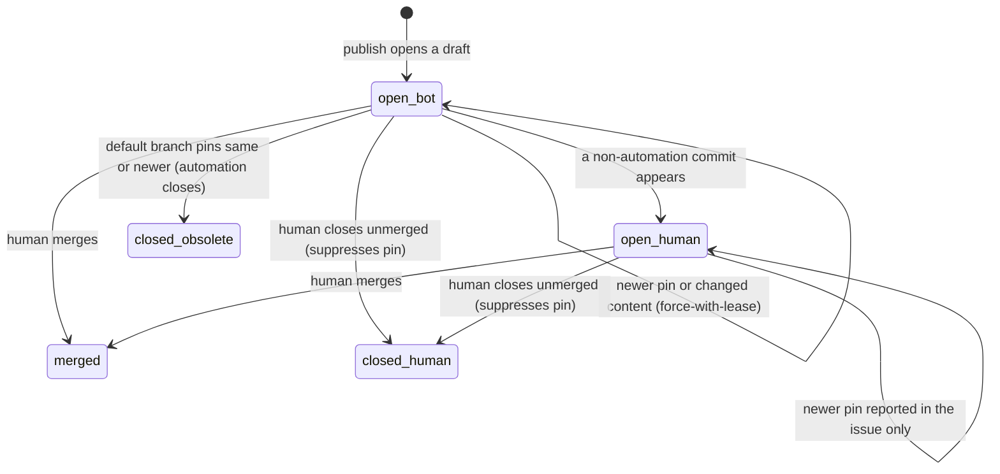

# Data Model: Upstream Upgrade Pull Requests

**Feature**: [spec.md](./spec.md) | **Research**: [research.md](./research.md)

All entities are JSON values that pass between workflow jobs, or markers inside GitHub
objects. Nothing persists outside git, the lock and GitHub's own PR and issue history.

## Upstream

| Field | Type | Rule |
|-------|------|------|
| `id` | `"speckit" \| "atv"` | Fixed set. Optional sources are excluded. |
| `policy` | `"release" \| "main"` | Spec Kit is always `release`. ATV follows the lock (research R-2). |
| `current` | Pin | Read from `baton.lock.json` on the base commit. |
| `latest` | Pin \| null | Newest eligible pin from detection. `null` when detection failed. |

## Pin

| Field | Type | Rule |
|-------|------|------|
| `version` | string \| null | `^\d+\.\d+\.\d+$`. `null` only for ATV with the `main` policy. |
| `commit` | string | `^[0-9a-f]{40}$` |
| `tree` | string \| null | `^[0-9a-f]{40}$`. Required for ATV. |
| `bump` | string | The exact `sync --bump` argument: `speckit=<ver>`, `atv=<ver>` or `atv=<sha>`. |

Ordering:

- Pins with the `release` policy compare by numeric semver.
- With the `main` policy, any commit different from the current one counts as newer.
- A version older than `current`, a pre-release or a draft is never eligible (FR-002).

## UpstreamPlan (output of `detect`; trusted)

| Field | Type | Rule |
|-------|------|------|
| `upstream` | Upstream | |
| `base` | string | The 40-hex default-branch HEAD the run is based on. |
| `action` | enum | One of: `none`, `generate`, `unchanged`, `suppressed`, `waiting-human`, `close-obsolete`, `obsolete-human`, `blocked` |
| `pr` | CandidatePR \| null | The open candidate PR, if one exists. |
| `blocker` | Blocker \| null | Required when `action = blocked`. |
| `publish` | boolean | `false` in preview mode or when the run's ref is not the default branch. |

State selection, evaluated in order:

1. Detection or format failure → `blocked`.
2. An open PR whose pin is no newer than `current` (that is, already merged or
   superseded) → `close-obsolete` if the PR is bot-only, otherwise `obsolete-human`
   (FR-029).
3. `latest` is null or not newer than `current` → `none`.
4. `latest` was suppressed by a PR a human closed → `suppressed` (FR-021).
5. An open PR that is human-edited → `waiting-human`. The newer pin is reported (FR-020).
6. An open bot-only PR with the same pin, the same base and an unchanged content digest
   → `unchanged` (FR-018).
7. Otherwise → `generate`.

## CandidateManifest (artifact from `generate`; untrusted until verified)

```json
{
  "schema": 1,
  "upstream": "speckit",
  "bump": "speckit=1.0.12",
  "pin": { "version": "1.0.12", "commit": "<40-hex>", "tree": null },
  "base": "<40-hex>",
  "changed": [{ "path": "packs/core/files/...", "sha256": "<64-hex>", "mode": "100644" }],
  "deleted": ["packs/core/files/..."],
  "summary": "<x-bump-summary text>",
  "checks": [{ "name": "npm run check", "result": "pass" }]
}
```

Validation in `publish` (research R-4):

- `upstream`, `bump` and `base` equal the UpstreamPlan.
- Paths are unique, relative and normalized, and pass the path policy.
- `sha256` matches the raw bytes.
- `mode` ∈ {`100644`, `100755`}.
- The `content digest` is the sha256 of the canonical manifest JSON with `checks`
  removed.

## CandidateResult (artifact from `generate` and output of `publish`)

| Field | Type | Rule |
|-------|------|------|
| `upstream` | id | |
| `stage` | `"detect" \| "generate" \| "validate" \| "publish"` | |
| `outcome` | `"opened" \| "updated" \| "unchanged" \| "closed-obsolete" \| "preview" \| "failed"` | |
| `pr` | number \| null | |
| `blocker` | Blocker \| null | |

## Blocker

| Field | Type | Rule |
|-------|------|------|
| `code` | string | A stable code such as `E_UPSTREAM_VERIFY`, `E_CHECK_FAILED`, `E_PATH_POLICY`, `E_PR_PERMISSION`, `E_LEASE`, `E_UNSUPPORTED_REF` or `E_SOURCE_MISMATCH`. |
| `stage` | stage | |
| `excerpt` | string | Sanitized: control characters stripped, at most 2,000 characters, fenced (research R-9). |
| `run` | string | The run URL, built from `GITHUB_SERVER_URL`, `GITHUB_REPOSITORY` and `GITHUB_RUN_ID`. |

## CandidatePR

| Field | Type | Rule |
|-------|------|------|
| `number` | int | |
| `branch` | string | `baton/upstream-upgrade/<id>` (FR-013) |
| `state` | `open-bot \| open-human \| merged \| closed-human \| closed-obsolete` | |
| `marker` | object | Parsed from `<!-- baton-upstream-candidate upstream=<id> pin=<bump> base=<sha> digest=<64-hex>[ closed=obsolete] -->` |

State transitions:



## Tracking issue row (one per upstream)

The columns are:

- Upstream
- Current pin
- Latest pin
- Candidate: an outcome or action, with the PR link
- Blocker: code, stage, run link and fenced excerpt

The issue stays open while any row has a newer pin, a pending candidate or a blocker, or
while verification fails. Otherwise it closes, as it does today (FR-023 to FR-025).
